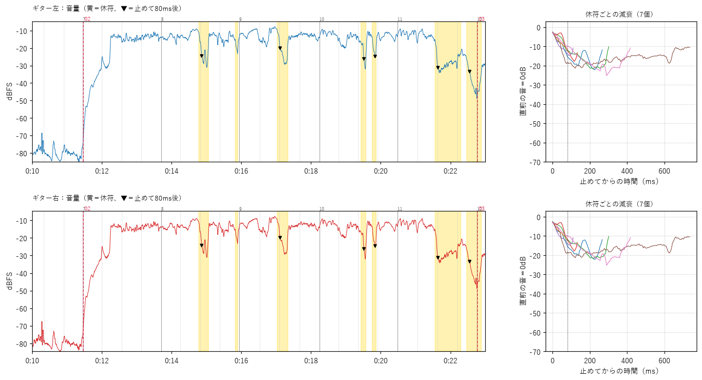
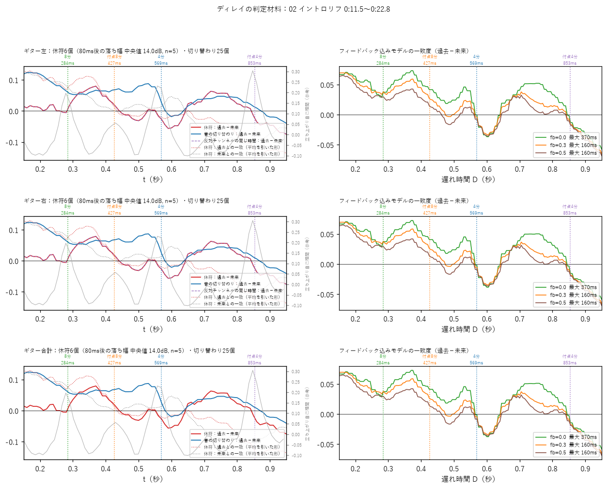

# Guitar Tone Analyzer

コピーバンドで原曲のギターの音を再現するための、**音源解析 × Claude Code の音作り提案システム**です。

原曲と「ギターだけを分離した音源」を Python で解析し、その数値と画像をもとに、Claude Code が自分の機材（エフェクター・アンプモデラー・マルチエフェクター）の具体的なツマミの値まで提案します。特に、耳で聴き分けにくい**ディレイ・リバーブ・コーラスなどの空間系エフェクト**が「どのパートの、どちらのギターに、どんな設定でかかっているか」の判定に力を入れています。

> 音源は著作物なので、このリポジトリには含めていません（曲名・アーティスト名も伏せています）。ディレイやフェイザーを仕込んだ試験曲を作るスクリプト（[tools/make_test_song.py](tools/make_test_song.py)）があるので、音源がなくても解析を一通り動かせます。手順は「[使い方](#使い方)」を参照。

## 何を解決したいか

- 原曲のギターに「ディレイがかかっている気がする」が、遅れ時間も、どのパートだけなのかも、耳だけでは決めきれない
- ライブの足元には制約がある（スイッチャーなし、曲中に踏めるのは1回ずつ、ギターが鳴っていない瞬間に踏みたい）
- 一般的な「この曲の音作り」の情報は、自分の機材と制約に合わない

## 仕組み

```
原曲 ＋ ギター分離音源
        │
        ▼
 analysis/（Python）── 数値（CSV・JSON）と画像（PNG）を毎回同じ方法で残す
        │                 ※「ディレイあり」などの判定はスクリプトではしない
        ▼
 Claude Code ── CLAUDE.md のルール（機材・操作の制約・判定の手順）に沿って
        │       数値と画像を自分で見て判定し、レポートを書く
        ▼
 レポート.md（パートごとの空間系の判定、ペダル・アンプ・パッチの設定、踏むタイミング）
        │
        ▼
 スタジオで実際に音を出して確認 ── 聴いた所感とのずれを指摘
        │
        └──► ルール（CLAUDE.md）と解析スクリプトを直す ──► 次の曲へ
```

## こだわったポイント：所感とのずれから改善し続けるループ

曲を解析するたびに、**自分の耳で聴いた所感と、解析・提案のずれを Claude Code に指摘し、ルールやスクリプトを直す**ことを繰り返す構造にしています。判定の根拠になる数値と画像を必ず残すので、「なぜずれたか」を後から説明できます。

実際にループを回して変わったこと：

| きっかけ | ずれ・問題 | 直したこと |
|---|---|---|
| 曲B（チャットでの試行） | ディレイを「立ち上がりの自己相関」で探すと、8分音符の刻みと区別できなかった | 休符に残る音の高さが「過去に弾いた音」と「後で弾く音」のどちらに似ているかを比べる方法と、繰り返し（フィードバック）込みのモデルの当てはめに変更。この方法で、リフのディレイを約285〜300msと推定した。立ち上がりの自己相関は参考値に格下げ |
| 曲B | ギターが長く休む場所に余韻がないだけで「ディレイなし」と判断しかけた | 休符の短いリフこそ個別に確認するルールを追加 |
| 曲A | 原曲がモノラルで、左右のギターを分けられなかった | 解析の最初に「ステレオかモノラルか」を確認し、モノラルなら左右を使う判定をしないルールを追加 |
| 曲A | 分離音源にキーボードが常に混ざり、どのパートでも「音が残っている」と出た | 他のパートと比べてそのパートだけの特徴と言えないときは、そう書くルールを追加。言えないことは言わない |
| 曲A | 提案ではパッチごとに音量を変えていたが、自分は手元のピッキングで強弱を付けたい | 3dB 未満の音量差はピッキングで指示し、パッチは分けないルールに変更 |
| 曲A | 0.3秒しかない隙間で踏む提案があり、本番で失敗しやすい | 短い隙間での切り替えは、パッチを減らしてなくせないか先に検討するルールを追加 |

**今の限界**も正直に残しています。曲A はモノラルで分離の質も低く、リフのディレイの遅れ時間は特定できませんでした。その場合は「候補の範囲と、スタジオで試す順番」を出す形にしています。解析スクリプトの既知の弱点は [analysis/README.md](analysis/README.md) にまとめています。

## 役割分担

- **Claude Code**：解析コード（`analysis/`）の実装、解析の実行、数値と画像を見た判定、レポートの作成
- **自分**
  - 何を解析し、何を判定させるかの設計と指示（[CLAUDE.md](CLAUDE.md)、[初回セットアップ用プロンプト.md](初回セットアップ用プロンプト.md)）
  - 機材と演奏の知識をルールにすること（接続順、操作の制約、パッチの分け方、踏む場所の条件）
  - スタジオでの検証と、所感とのずれの指摘・ルールの改善

## 実例

- **曲A**（[songs/曲A](songs/曲A)）：解析からスタジオでの確定まで一通り回した例
  - [レポート.md](songs/曲A/results/レポート.md)：判定と提案
  - [最終設定.md](songs/曲A/results/最終設定.md)：スタジオで確定した設定と、提案からのずれ（ソロの音量 +3dB → +6dB、歪みを足した、など）
  - [summary.md](songs/曲A/results/summary.md)：解析の数値のまとめ
- **曲B**（[songs/曲B](songs/曲B)）：Claude Code に移る前の、チャットで試行していた段階の提案

曲A のリフの休符の残り方（黄色＝休符、右＝休符ごとの減衰）：



ディレイの判定材料（休符の音の高さが過去・未来のどちらに似ているか／繰り返し込みのモデル）：



※ 曲名・アーティスト名は伏せています。音源は著作物なので、このリポジトリには含めていません。

## 使い方

Python 3.10 以上。

```
python -m venv .venv
.venv\Scripts\python -m pip install -r requirements.txt      # Mac は .venv/bin/python
```

音源なしで試す（ディレイ・フェイザー・キメを仕込んだ合成の試験曲を作る）：

```
.venv\Scripts\python tools/make_test_song.py songs/テスト曲
.venv\Scripts\python -m analysis.run songs/テスト曲
```

試験曲は 175BPM ですが、テンポは半分の 87.6BPM と出ます（既知の弱点。[analysis/README.md](analysis/README.md) を参照）。

自分の曲を解析する：`songs/_テンプレート` をコピーして、`audio/` に原曲とギター分離音源、`request.md` に聴いた印象のメモを書き、Claude Code に「songs/<曲名> を解析して、音作りを提案して」と送ります。詳しくは [使い方.md](使い方.md)、コマンドと出力の一覧は [analysis/README.md](analysis/README.md)。

## フォルダー構成

```
CLAUDE.md                       Claude Code へのルール（役割・機材・制約・判定の手順・出力の形式）
初回セットアップ用プロンプト.md   解析スクリプトを作らせたときの指示
使い方.md                        人間向けの使い方
analysis/                       解析スクリプト（Python：numpy・scipy・librosa・matplotlib・pandas）
gear/                           アンプモデラーの枠とマルチエフェクターのバンクの使い方
songs/_テンプレート/              新しい曲を始めるときのひな形
songs/曲A/、songs/曲B/            実例
tools/make_test_song.py         動作確認用の合成の試験曲を作る
```

## 使っている機材（ルールの前提）

PRS S2 Standard → RAT2 → OD GLOVE → BOSS BD-2 → TONEX ONE → SCH-Z → ZOOM G1X FOUR → スタジオの Marshall（パワーアンプ）
